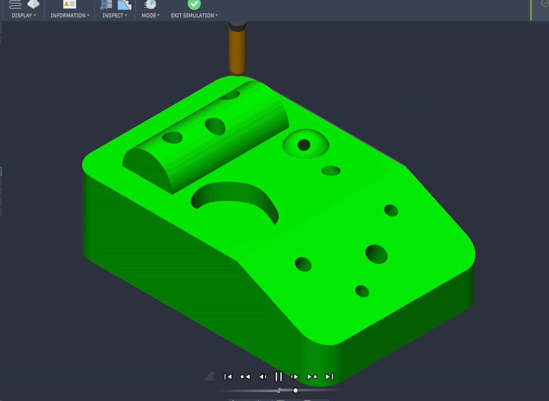
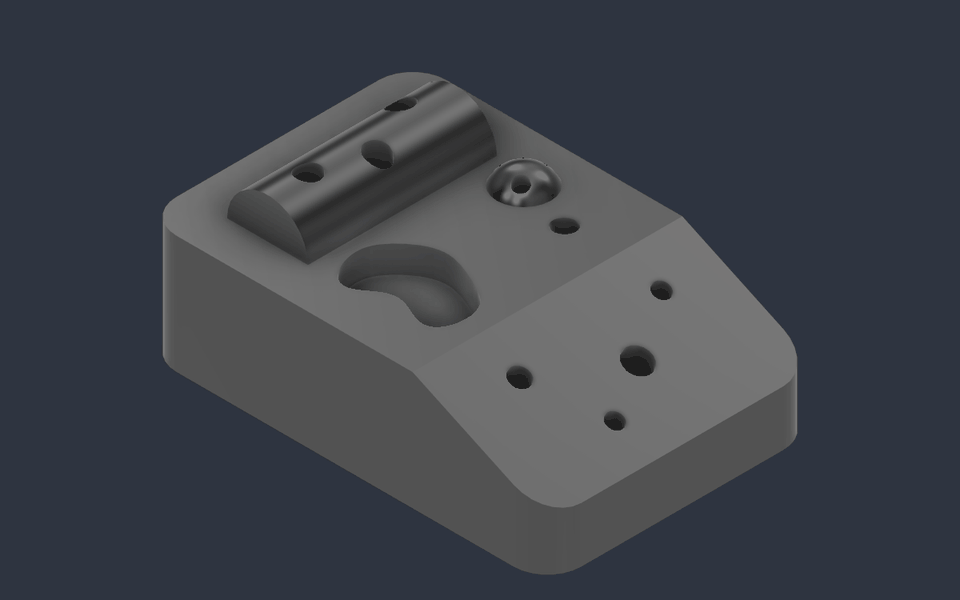
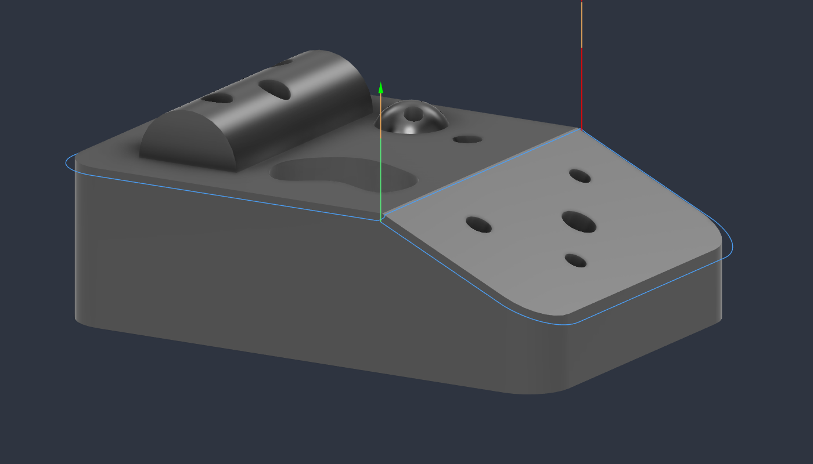
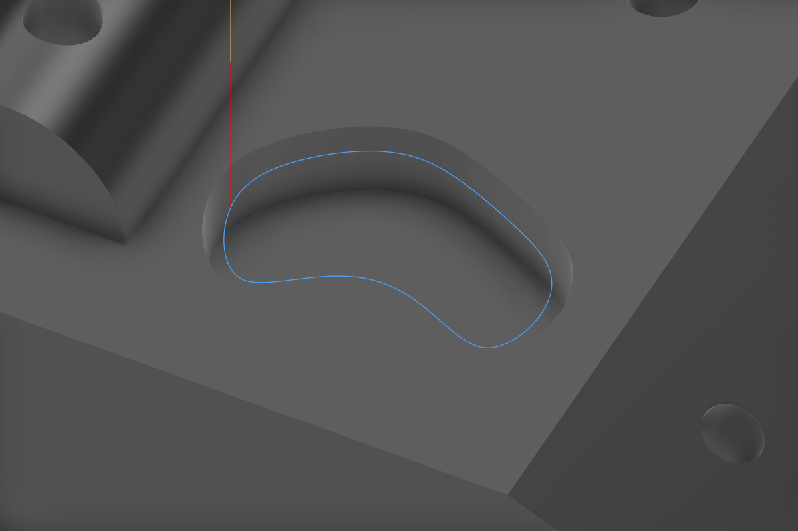
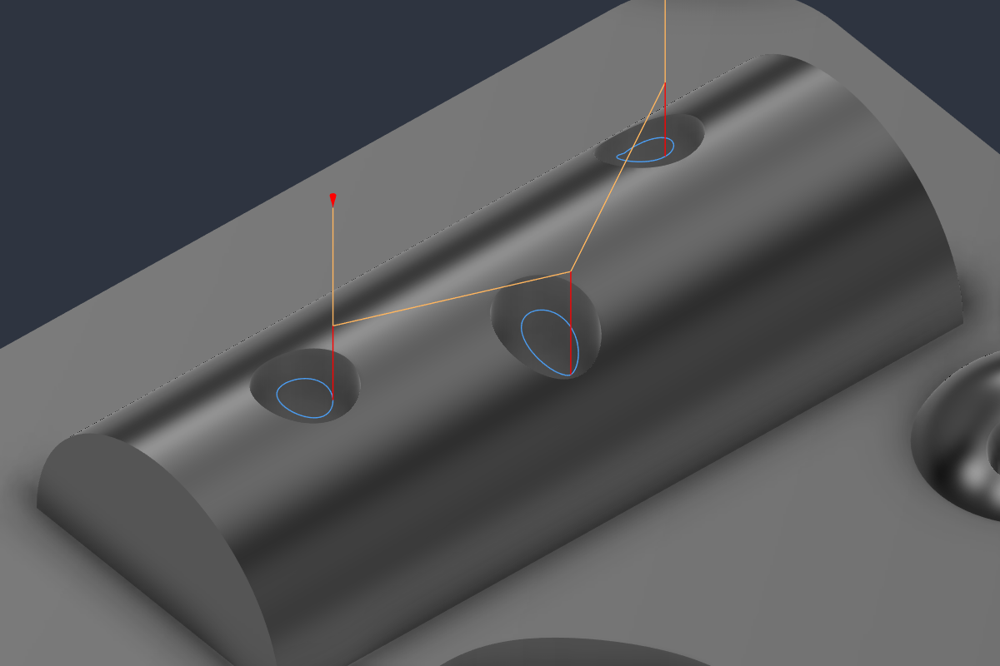
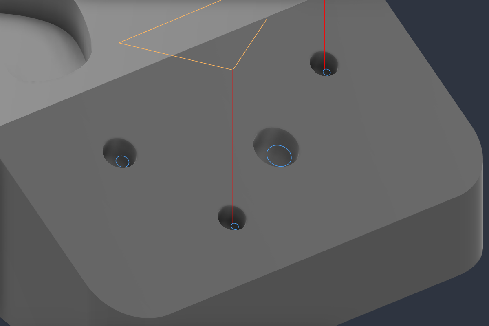
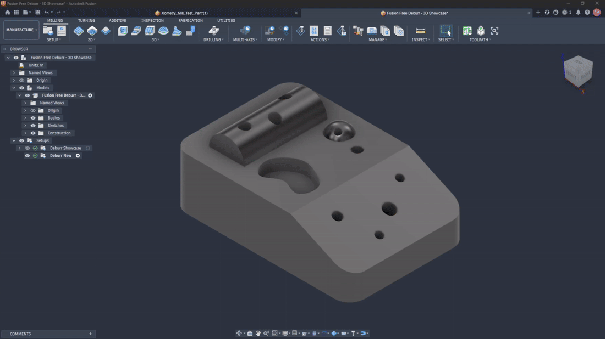

# Fusion Free Deburr

  

**Free 3-axis deburring toolpaths for Autodesk Fusion, using a ball end mill.**

[Download the latest release](https://github.com/jkkicks/Fusion-Free-Deburr/releases)

*Fusion simulation of the showcase part.*

*Selected edges and their resulting toolpaths.*

## Examples

| Curved edges and varying Z | Freeform pocket |
| :---: | :---: |
|  |  |
| **Saddle holes** | **Holes on a slope** |
|  |  |

## Install

1. Download the ZIP from the [latest release](https://github.com/jkkicks/Fusion-Free-Deburr/releases) and extract it.
2. In Fusion, press **Shift+S** to open **Scripts and Add-Ins**, or find it under **Utilities > Add-Ins**.
3. Click **+** beside **My Add-Ins**, select the extracted `FusionFreeDeburr` folder, and run the add-in.

## Use

In **Manufacture > Milling > 3D > Ball Deburr**, select the edges, choose a ball end mill, set the edge-break width, and generate the toolpath. Right-click the operation to edit it later.

*Select edges, choose a tool and set the edge-break width.*

## How it works

Fusion Free Deburr generates custom 3D sketch geometry and uses Fusion's native Trace strategy to create the toolpath.

> **Alpha software:** Simulate and inspect the toolpath before machining.
